<div align="center">
  
</div>

```bash

┌──(naresh💀kali)-[~/profile]
└─$ cat << "EOF"
 _       __     __                             
| |     / /__  / /________  ____ ___  ___      
| | /| / / _ \/ / ___/ __ \/ __ `__ \/ _ \     
| |/ |/ /  __/ / /__/ /_/ / / / / / /  __/     
|__/|__/\___/_/\___/\____/_/ /_/ /_/\___/      
EOF
[+] SYSTEM: Kali Linux x86_64 // Custom Hardware & IoT Lab
[+] PROFILE: Naresh (@Naresh-sh) // Elite Developer Mode Active
[+] ARCADE: 4 In-Profile Games Initialized [Zero-Redirect Engine]
```
---

### 🌐 Socials & Connect
Hi, I'm Naresh, I work on Kali Linux, enjoy hands-on prototyping, and I'm always learning something new.

<p align="left">
  <a href="https://bsky.app/profile/Navita" target="_blank">
    
  </a>
  <a href="https://behance.net/Maker_studioz" target="_blank">
    
  </a>
  <a href="https://www.instagram.com/_nodespo/" target="_blank">
    
  </a>
  <a href="https://linkedin.com/in/https://www.linkedin.com/feed/foryou/" target="_blank">
    
  </a>
  <a href="https://medium.com/@Makerbazar.com" target="_blank">
    
  </a>
  <a href="https://mastodon.social/@Naresh" target="_blank">
    
  </a>
  <a href="mailto:nareshraj112211@gmail.com" target="_blank">
    
  </a>
</p>

### 🛠️ Skills

- **Embedded / IoT:** ESP32, ESP32-CAM, Arduino IDE, C/C++, I2S audio, GPS (NEO-6M), OLED (SSD1306)
- **Mobile:** Native Android development
- **Hardware & Design:** 3D modeling and printing (STL), enclosure design, electronics prototyping, SVG / logo design
- **Tools & Platforms:** Linux (Kali), Git & GitHub, REST APIs, AI/LLM APIs, WhatsApp automation

### 💻 Tech Stack

<p align="left">
  
</p>

<p align="left">
  
  
  
  
  
  
  
  
  
  
  
  
  
  
  
  
  
  
  
  
  
  
  
  
  
  
  
  
</p>
### 📫 Connect With Me

- GitHub: [@Naresh-sh](https://github.com/Naresh-sh)
- Email: nareshraj112211@gmail.com

⭐ If you like my work, drop a star on my repos!

### 🕹️ Hacker Arcade (Native On Profile • Zero Redirects)

> [!NOTE]
> All games below run **directly on this GitHub profile** with zero external redirects. 

<div align="center">

| ❌ **Tic-Tac-Toe (Solo vs Minimax AI)** | 🐍 **Retro Snake 8-Bit** |
| :---: | :---: |
|  |  |
| 🦖 **Chrome Dino Runner** | 👾 **Space Invaders Arcade** |
|  |  |

</div>

<details>
<summary>🎮 <b>[CLICK TO PLAY] Interactive Tic-Tac-Toe vs Minimax Algorithm (In-README)</b></summary>

<br/>

> **Game Rules**: You are **❌ (Player)**. The computer is **🤖 (Minimax AI)**. Click any move below to challenge the algorithm:

#### Turn 1: Select your first move:
<details>
<summary>▶ Play <b>Center [Position 5]</b></summary>

- **Your Move**: ❌ at Center (Position 5)
- **Minimax Algorithm Calculation**: *Depth 9 search → Optimal counter to prevent diagonal fork is taking Corner (Position 1)*
- **AI Move**: 🤖 at Top-Left (Position 1)

```
   1   |   2   |   3  
  🤖   |  ⬜   |  ⬜  
-------+-------+-------
   4   |   5   |   6  
  ⬜   |  ❌   |  ⬜  
-------+-------+-------
   7   |   8   |   9  
  ⬜   |  ⬜   |  ⬜  
```

<details>
<summary>▶ [Turn 2] Play <b>Bottom-Right [Position 9]</b></summary>

- **Your Move**: ❌ at Position 9
- **Minimax AI**: *Detects dual diagonal threat → Counters with Position 3 (Top-Right)*
- **AI Move**: 🤖 at Position 3

```
  🤖   |  ⬜   |  🤖  
-------+-------+-------
  ⬜   |  ❌   |  ⬜  
-------+-------+-------
  ⬜   |  ⬜   |  ❌  
```

<details>
<summary>▶ [Turn 3] Play <b>Top-Center [Position 2]</b> (Block AI Win!)</summary>

- **Your Move**: ❌ at Position 2 (blocking AI top row)
- **Minimax AI**: *Blocks user column and forces tie/win → Plays Position 8*

```
  🤖   |  ❌   |  🤖  
-------+-------+-------
  ⬜   |  ❌   |  ⬜  
-------+-------+-------
  ⬜   |  🤖   |  ❌  
```

<details>
<summary>▶ [Turn 4] Play <b>Mid-Left [Position 4]</b></summary>

- **Your Move**: ❌ at Position 4
- **Minimax AI**: *Plays remaining cell Position 6*

```
  🤖   |  ❌   |  🤖  
-------+-------+-------
  ❌   |  ❌   |  🤖  
-------+-------+-------
  ⬜   |  🤖   |  ❌  
```

🏁 **RESULT: HARD-FOUGHT DRAW! (Minimax Unbeatable Defense)**
</details>
</details>
</details>

<details>
<summary>▶ [Turn 2] Play <b>Mid-Right [Position 6]</b></summary>

- **Your Move**: ❌ at Position 6
- **Minimax AI**: *Plays Position 4 to intercept horizontal progression*

```
  🤖   |  ⬜   |  ⬜  
-------+-------+-------
  🤖   |  ❌   |  ❌  
-------+-------+-------
  ⬜   |  ⬜   |  ⬜  
```
🏁 **AI Evaluates Advantage: Defense Locked!**
</details>
</details>

<details>
<summary>▶ Play <b>Top-Left Corner [Position 1]</b></summary>

- **Your Move**: ❌ at Top-Left (Position 1)
- **Minimax Algorithm Calculation**: *Facing corner opening → Center control is mathematically optimal*
- **AI Move**: 🤖 at Center (Position 5)

```
   1   |   2   |   3  
  ❌   |  ⬜   |  ⬜  
-------+-------+-------
   4   |   5   |   6  
  ⬜   |  🤖   |  ⬜  
-------+-------+-------
   7   |   8   |   9  
  ⬜   |  ⬜   |  ⬜  
```

<details>
<summary>▶ [Turn 2] Play <b>Bottom-Right Corner [Position 9]</b></summary>

- **Your Move**: ❌ at Position 9
- **Minimax AI**: *Plays Edge Position 2 to prevent user fork*

```
  ❌   |  🤖   |  ⬜  
-------+-------+-------
  ⬜   |  🤖   |  ⬜  
-------+-------+-------
  ⬜   |  ⬜   |  ❌  
```
🏁 **Minimax controls board geometry!**
</details>
</details>

<details>
<summary>▶ Play <b>Top-Center Edge [Position 2]</b></summary>

- **Your Move**: ❌ at Top-Center (Position 2)
- **Minimax Algorithm Calculation**: *Takes Center (Position 5) with positive evaluation*
- **AI Move**: 🤖 at Center (Position 5)

```
   1   |   2   |   3  
  ⬜   |  ❌   |  ⬜  
-------+-------+-------
   4   |   5   |   6  
  ⬜   |  🤖   |  ⬜  
-------+-------+-------
   7   |   8   |   9  
  ⬜   |  ⬜   |  ⬜  
```
</details>

</details>

---

### 📊 GitHub Stats


### 🏆 GitHub Trophies


### ✍️ Random Dev Quote


### 🔝 Top Contributed Repo


---
[](https://visitcount.itsvg.in)

<!-- Proudly created with GPRM ( https://gprm.itsvg.in ) -->
